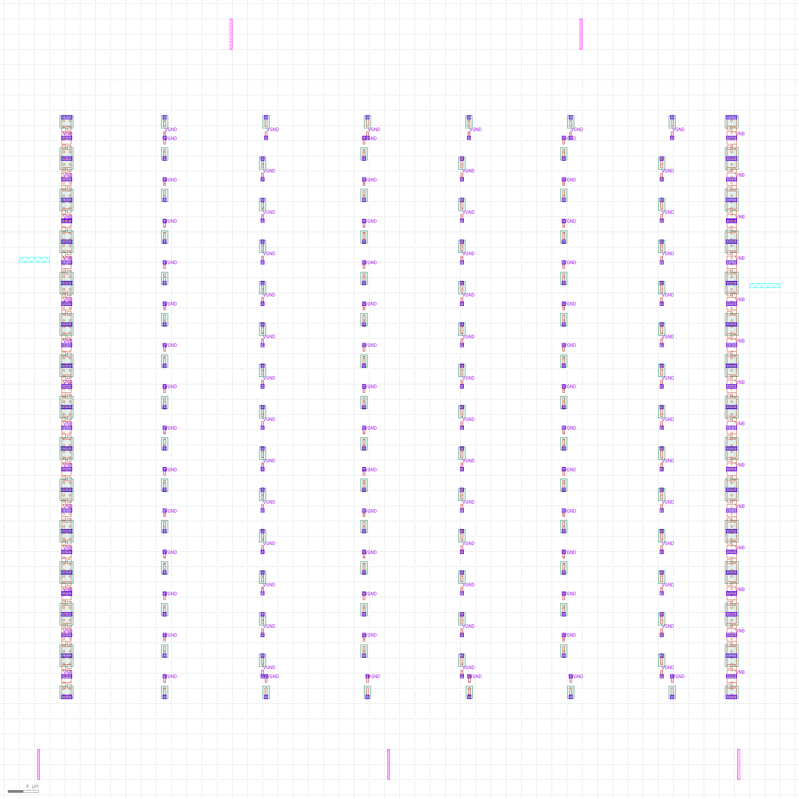
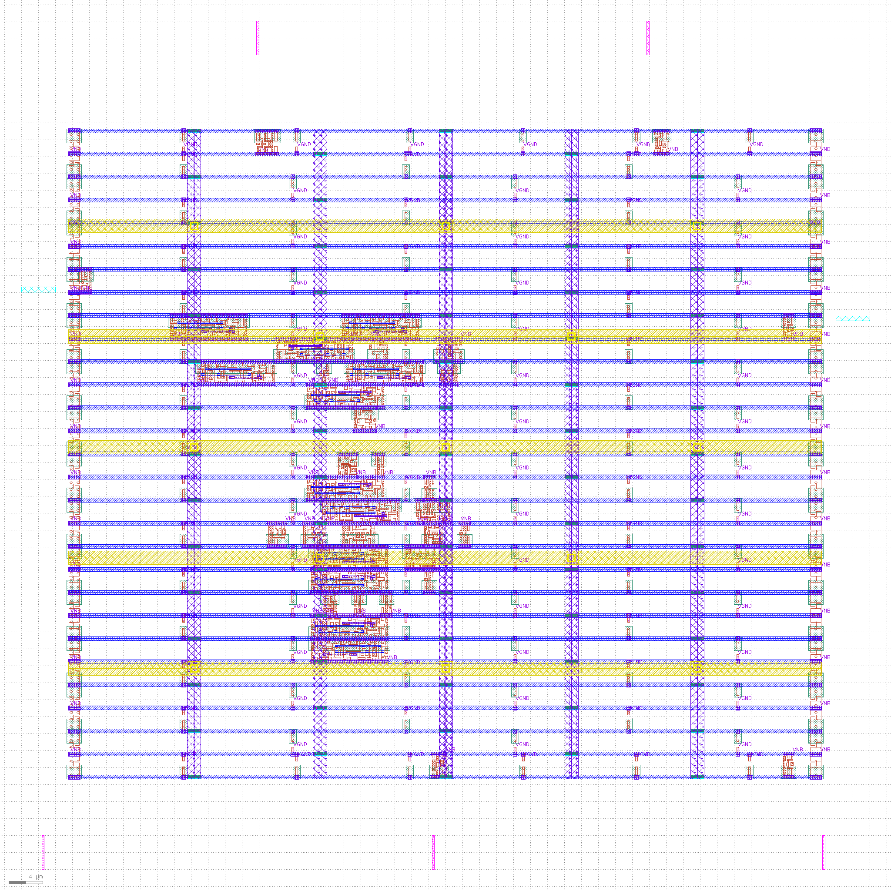
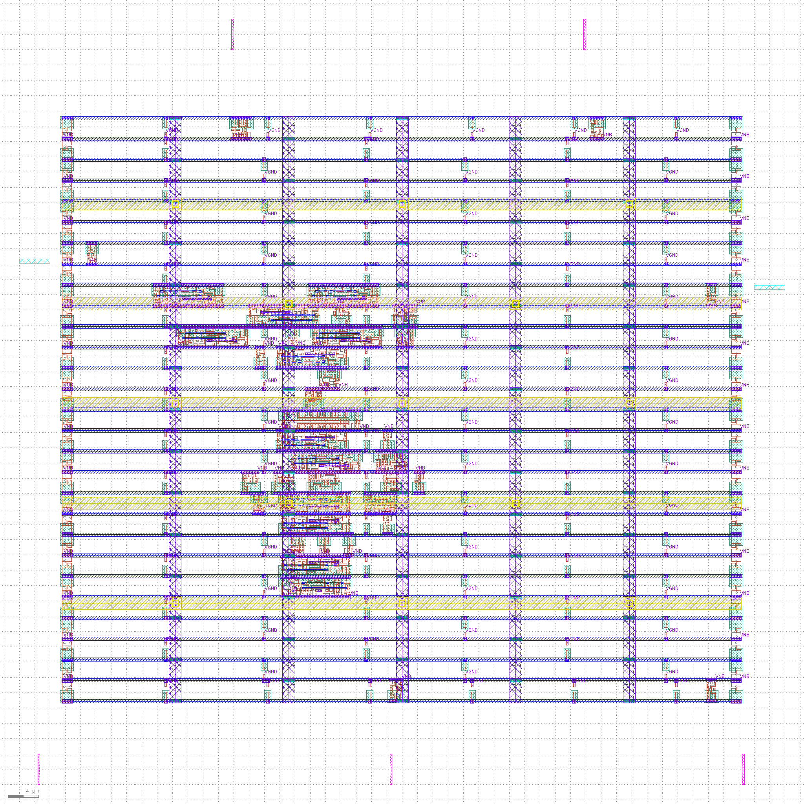
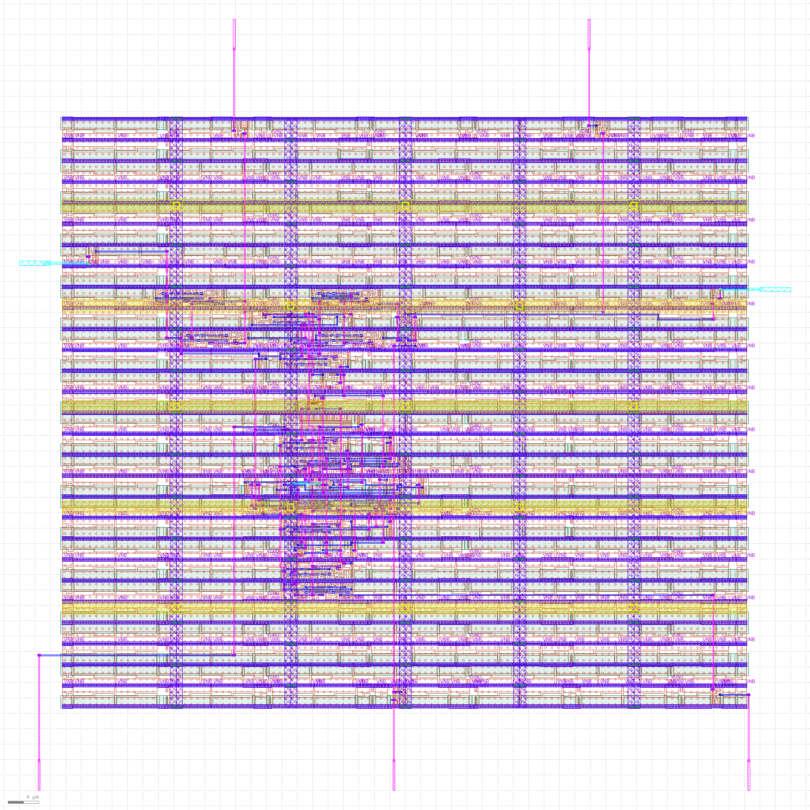
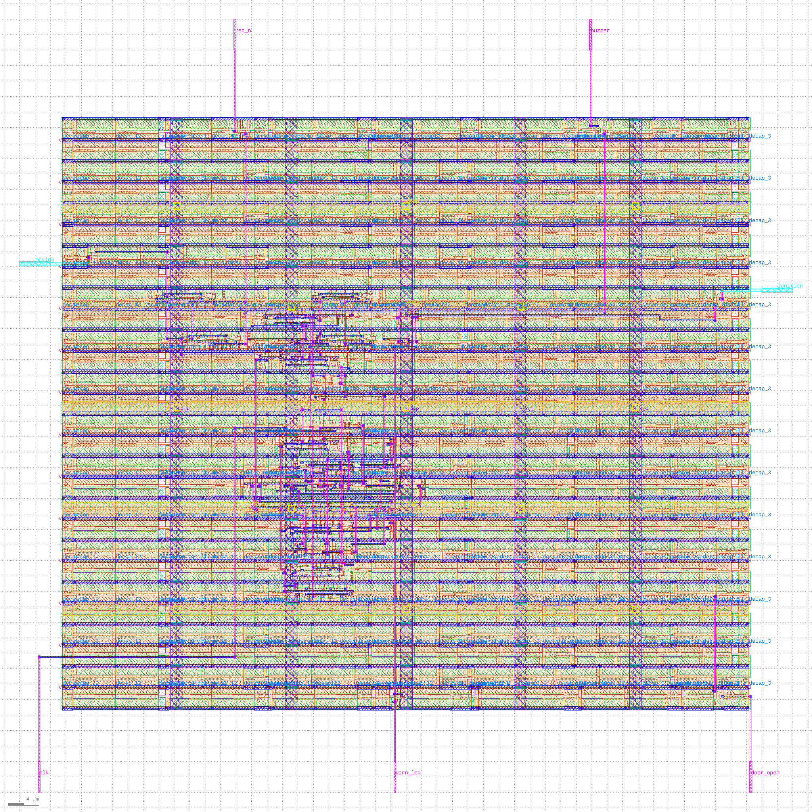

# Car Door-Open Warning Controller with Flicker Filtering

A Verilog RTL design that detects a persistently open vehicle door, filters short door-switch flickers, synchronizes asynchronous inputs, and generates visual and audible warnings. The design was taken through simulation, synthesis, static timing analysis (STA), and an OpenLane physical-design flow targeting the SkyWater SKY130 HD standard-cell library.

> **Project status:** RTL and gate-level simulations pass all 15 test checks. The physical-design reports record zero routing DRC violations, zero Magic DRC violations, zero antenna violations, and a successful LEF-based LVS comparison. The post-route STA results also document one setup violation at the out-of-range `ss_n40C_1v28` corner; see [Post-route STA](#post-route-sta).

## Project at a glance

| Item | Details |
|---|---|
| Design | Car Door-Open Warning Controller with Flicker Filtering |
| RTL language | Verilog |
| Target library | SkyWater SKY130A, `sky130_fd_sc_hd` |
| Simulation | Icarus Verilog, GTKWave |
| Synthesis | Yosys |
| Timing analysis | OpenSTA |
| Physical-design flow | OpenLane v0.21 |
| Clock period used for STA | 10 ns |
| Die area | 100 × 100 µm |
| Flicker-filter parameter | `DELAY = 8` clock cycles |

## Contents

- [Overview](#overview)
- [Architecture and behaviour](#architecture-and-behaviour)
- [Interface](#interface)
- [Implementation details](#implementation-details)
- [Validation results](#validation-results)
- [Simulation](#simulation)
- [Synthesis](#synthesis)
- [Pre-route STA](#pre-route-sta)
- [Physical design](#physical-design)
- [Post-route STA](#post-route-sta)
- [Reproducing the flow](#reproducing-the-flow)
- [Repository files and reports](#repository-files-and-reports)
- [Challenges faced](#challenges-faced)
- [Limitations and interpretation](#limitations-and-interpretation)

---

## Overview

A vehicle should alert the driver when a door remains open while the ignition is on. If the vehicle is moving, the system should raise a stronger warning. A real door switch can briefly toggle as it opens or closes, so the controller filters short pulses rather than responding immediately to every transition.

The implementation addresses three design concerns:

1. **Input synchronization:** `door_open`, `ignition`, and `moving` are asynchronous to the controller clock. Each signal passes through a two-flip-flop synchronizer.
2. **Flicker filtering:** a counter requires the synchronized door signal to remain asserted for the configured number of clock cycles.
3. **Warning control:** a three-state controller selects idle, visual-warning, or audible-alarm behaviour.

This is a digital RTL project and an open-source implementation exercise. It is not a production-qualified automotive safety component.

## Architecture and behaviour

```text
door_open ──> [2-flop synchronizer] ──> [DELAY counter / filter] ──┐
ignition  ──> [2-flop synchronizer] ───────────────────────────────┤
moving    ──> [2-flop synchronizer] ───────────────────────────────┤
                                                                   v
                                                        [3-state controller]
                                                          |             |
                                                       warn_led       buzzer

clk and active-low asynchronous rst_n drive the sequential logic.
```

### Behaviour table

The warning is enabled only when the door has been stably open and the ignition is on.

| Condition | `warn_led` | `buzzer` |
|---|---:|---:|
| Door not stably open | 0 | 0 |
| Door stably open, ignition off | 0 | 0 |
| Door stably open, ignition on, vehicle stopped | 1 | 0 |
| Door stably open, ignition on, vehicle moving | 1 | 1 |

### Design sequence

1. **Synchronize inputs.** Each asynchronous input passes through two flip-flops clocked by `clk`.
2. **Filter the door signal.** The counter increments while the synchronized door signal is high, clears when the door closes, and stops incrementing at `DELAY`.
3. **Choose the state.** The FSM returns to `IDLE` unless the door is stably open and ignition is on. Under that condition it selects `WARN` if stopped or `ALARM` if moving.
4. **Drive outputs.** `warn_led` is high in either warning state. `buzzer` is high only in `ALARM`.
5. **Reset.** `rst_n` is active-low and asynchronous.

### State encoding

| State | Encoding | Meaning |
|---|---:|---|
| `IDLE` | `2'b00` | No warning |
| `WARN` | `2'b01` | Visual warning |
| `ALARM` | `2'b10` | Visual and audible warning |

## Interface

| Signal | Direction | Description |
|---|---|---|
| `clk` | Input | Controller clock |
| `rst_n` | Input | Active-low asynchronous reset |
| `door_open` | Input | High when a door is open; asynchronous input |
| `ignition` | Input | High when ignition is on; asynchronous input |
| `moving` | Input | High when the vehicle is moving; asynchronous input |
| `warn_led` | Output | Visual warning indicator |
| `buzzer` | Output | Audible warning indicator |

**Parameter:** `DELAY = 8`. The synchronized door input must remain high until the counter reaches the threshold. The counter width is `$clog2(DELAY + 1)`, which is 4 bits for the default value.

## Implementation details

The implementation contains 12 flip-flops according to the design breakdown:

| Block | Flip-flops |
|---|---:|
| Three two-flop input synchronizers | 6 |
| Delay counter | 4 |
| FSM state register | 2 |
| **Total** | **12** |

The full RTL implementation is in [`door_warning.v`](door_warning.v). The self-checking testbench is in [`tb_door_warning.v`](tb_door_warning.v).

## Validation results

### Summary

| Validation stage | Reported result |
|---|---|
| RTL simulation | **15 / 15 checks passed** |
| Gate-level simulation | **15 / 15 checks passed** |
| Standalone Yosys synthesis | 31 cells; 12 flip-flops; 409.14 µm² |
| Pre-route STA | All 16 reported PVT corners met with `rst_n` input delay set to 5 ns |
| Post-route STA at intended operating points | All listed in-range points met at a 10 ns clock |
| Post-route STA across all 16 listed corners | 15 met; `ss_n40C_1v28` has −2.73 ns setup slack |
| TritonRoute DRC | No violations reported |
| Magic DRC | `COUNT: 0` |
| Antenna check | 0 pins and 0 nets violated; 45 nets checked |
| Netgen LVS | 0 errors; “Circuits match uniquely” in the reported LEF-based comparison |

The two STA stages use different netlists and parasitic assumptions; their results should not be treated as one identical timing experiment. See the detailed sections below.

## Simulation

The testbench checks reset behaviour, idle conditions, ignition gating, warning-only and alarm states, door closure, motion changes, short door pulses, and reset during an alarm. Comparisons that check low outputs use case inequality (`!==`) so unknown values do not accidentally pass as valid zeros.

### Run the simulations

Run these commands from the project directory:

```bash
./run_sim.sh rtl
./run_sim.sh gls
```

Open the generated waveforms in GTKWave:

```bash
gtkwave door_warning_rtl.vcd
gtkwave door_warning_gls.vcd
```

### Simulation artefacts

- RTL result: [`rtl_result.txt`](rtl_result.txt)
- Gate-level result: [`gls_result.txt`](gls_result.txt)
- RTL waveform: [`door_warning_rtl.vcd`](gtkwave_2.png)
- Gate-level waveform: [`door_warning_gls.vcd`](gtkwave_netlist2.png)
- Simulation runner: [`run_sim.sh`](run_sim.sh)

**Gate-level note:** the Sky130 functional models require the simulation defines `-DFUNCTIONAL` and `-DUNIT_DELAY=#1`. The project runner is intended to apply the required gate-level options and include the relevant standard-cell model sources.

## Synthesis

Standalone Yosys synthesis maps the RTL to the Sky130 HD library. The reported standalone result is **31 cells**, including **12 `dfrtp_1` flip-flops**, with an area of **409.14 µm²**.

The OpenLane synthesis stage reports **447.93 µm²**. This differs from the standalone Yosys result because the two synthesis flows are not identical; the values are kept separate rather than presented as if they were the same netlist.

### Synthesis command outline

The following is the command sequence documented for the standalone flow. The Liberty path must point to the Sky130 HD library installed in your environment.

```tcl
read_verilog door_warning.v
synth -top door_warning
dfflibmap -liberty sky130_fd_sc_hd__tt_025C_1v80.lib
abc -liberty sky130_fd_sc_hd__tt_025C_1v80.lib
stat -liberty sky130_fd_sc_hd__tt_025C_1v80.lib
write_verilog -noattr door_warning_net.v
```

### Synthesis artefacts

- Mapped netlist: [`door_warning_net.v`](door_warning_net.v)
- Synthesis log: [`yosys_log.txt`](yosys_log.txt)
- OpenLane synthesis statistics: [`1-yosys_4.stat.rpt`](1-yosys_4.stat.rpt)

## Pre-route STA

Pre-route STA evaluates the standalone synthesized netlist using the timing constraints in [`door_warning.sdc`](door_warning.sdc). The clock period is 10 ns. The three functional inputs have 2 ns input delay, the outputs have 2 ns output delay, and `rst_n` has a 5 ns input delay in the final constraint file.

```tcl
create_clock -name clk -period 10 [get_ports clk]
set_input_delay 2 -clock clk [get_ports {door_open ignition moving}]
set_input_delay 5 -clock clk [get_ports rst_n]
set_output_delay 2 -clock clk [get_ports {warn_led buzzer}]
```

The earlier file [`door_warning_v1.sdc`](door_warning_v1.sdc) used a 2 ns input delay for `rst_n`. Under that assumption, a −0.28 ns reset-removal violation was reported at `ss_n40C_1v28`. With the `rst_n` input delay changed to 5 ns, the pre-route reports record all 16 listed corners as meeting the checked timing constraints. This result depends on the stated input-delay assumption.

### Pre-route STA scripts and reports

- Main script: [`sta_instructor.tcl`](sta_instructor.tcl)
- Corner-report script: [`sta_screen.tcl`](sta_screen.tcl)
- Individual corner reports: [`sta_reports_full/`](sta_reports_full/)

The report folder links below are repository-relative and work when the corresponding files are committed under these names.

| PVT corner | Report |
|---|---|
| `ff_100C_1v65` | [Open report](sta_reports_full/ff_100C_1v65.txt) |
| `ff_100C_1v95` | [Open report](sta_reports_full/ff_100C_1v95.txt) |
| `ff_n40C_1v56` | [Open report](sta_reports_full/ff_n40C_1v56.txt) |
| `ff_n40C_1v65` | [Open report](sta_reports_full/ff_n40C_1v65.txt) |
| `ff_n40C_1v76` | [Open report](sta_reports_full/ff_n40C_1v76.txt) |
| `ff_n40C_1v95` | [Open report](sta_reports_full/ff_n40C_1v95.txt) |
| `ss_100C_1v40` | [Open report](sta_reports_full/ss_100C_1v40.txt) |
| `ss_100C_1v60` | [Open report](sta_reports_full/ss_100C_1v60.txt) |
| `ss_n40C_1v28` | [Open report](sta_reports_full/ss_n40C_1v28.txt) |
| `ss_n40C_1v35` | [Open report](sta_reports_full/ss_n40C_1v35.txt) |
| `ss_n40C_1v40` | [Open report](sta_reports_full/ss_n40C_1v40.txt) |
| `ss_n40C_1v44` | [Open report](sta_reports_full/ss_n40C_1v44.txt) |
| `ss_n40C_1v60` | [Open report](sta_reports_full/ss_n40C_1v60.txt) |
| `ss_n40C_1v76` | [Open report](sta_reports_full/ss_n40C_1v76.txt) |
| `tt_025C_1v80` | [Open report](sta_reports_full/tt_025C_1v80.txt) |
| `tt_100C_1v80` | [Open report](sta_reports_full/tt_100C_1v80.txt) |

## Physical design

The design was taken through OpenLane v0.21 targeting the SkyWater SKY130A PDK and the `sky130_fd_sc_hd` standard-cell library. The configured die area is 100 × 100 µm, the target clock period is 10 ns, placement density is 0.4, and the synthesis strategy is area-oriented.

### Main configuration

See [`config.tcl`](config.tcl).

| Setting | Value |
|---|---|
| Die area | `0 0 100 100` µm; absolute floorplan sizing |
| Clock period | 10 ns |
| Placement density target | 0.4 |
| Standard-cell library | `sky130_fd_sc_hd` |
| Synthesis strategy | `AREA 0` |

### Flow stages

The documented OpenLane sequence is:

```tcl
prep -design door_warning -tag run1
run_synthesis
run_floorplan
run_placement
run_cts
run_routing
write_powered_verilog
set_netlist $::env(lvs_result_file_tag).powered.v
run_magic
run_magic_spice_export
run_magic_drc
run_lvs
run_antenna_check
```

Do not add `-overwrite` to an existing run unless you intend to discard its existing results. The exact container setup and environment paths depend on the local OpenLane/PDK installation.

### Reported physical-design results

| Stage / check | Reported result |
|---|---|
| OpenLane synthesis | 447.93 µm² |
| Floorplan | 100 × 100 µm die; power grid generated |
| Physical-only cells | 56 end caps, 90 tap cells, 0 diodes |
| Clock-tree synthesis | Slack met; WNS/TNS 0.00 in the flow report |
| Global routing | Slack met; WNS/TNS 0.00 in the flow report |
| Detailed routing | No DRC violations reported |
| Final layout | 691 instances including fill/decap/tap; 48 devices after Netgen merging |
| Pins | 7 signal pins and 10 power pins |

### Physical-design screenshots

The images below are linked by relative path. GitHub displays them inline when the PNGs are committed beside this README.

**Floorplan**



**Placement**



**Clock-tree synthesis**



**Routed design**



**Final GDS layout**



### DRC, antenna and LVS

| Check | Result | Report |
|---|---|---|
| Magic DRC | `COUNT: 0` | [`30-29-magic.drc`](30-29-magic.drc) |
| Antenna check | 0 pins and 0 nets violated; 45 nets checked | [`37-antenna.rpt`](37-antenna.rpt) |
| Netgen LVS | 0 errors; “Circuits match uniquely” | [`door_warning.lvs.lef.log`](door_warning.lvs.lef.log), [`door_warning.lvs_parsed.lef.log`](door_warning.lvs_parsed.lef.log) |

**LVS scope:** the documented comparison is LEF-based, with standard cells treated as black boxes. It is not a transistor-level comparison of the extracted GDS against a transistor-level reference netlist.

The first LVS attempt compared the extracted layout with an unpowered pre-route netlist and reported two unmatched power nets. The log notes that the devices and pins matched, while the differences involved `VPWR`/`VGND` connections for tap, decap, and fill cells. Generating and using the powered netlist resolved the reported mismatch in the final LEF-based LVS run.

### Physical-design logs and outputs

- CTS log: [`13-cts.log`](13-cts.log)
- Global-routing log: [`16-fastroute.log`](16-fastroute.log)
- Final routed DEF: [`door_warning.def`](door_warning.def)
- Abstract LEF: [`door_warning.lef`](door_warning.lef)
- GDS layout: [`door_warning.gds`](door_warning.gds)
- Powered netlist: [`door_warning.lvs.powered.v`](door_warning.lvs.powered.v)

## Post-route STA

Post-route STA uses the powered routed netlist, the extracted SPEF parasitics, the same SDC constraints, and a propagated clock. The script is [`sta_postroute.tcl`](sta_postroute.tcl); the extracted parasitics are in [`door_warning.spef`](door_warning.spef).

The reported table below covers 16 listed PVT corners at a 10 ns clock. Recovery, setup, removal, and hold values are shown in nanoseconds, in the order recorded in the project report.

### Post-route results

| Corner | Recovery (ns) | Setup (ns) | Removal (ns) | Hold (ns) | WNS (ns) | TNS (ns) | Status |
|---|---:|---:|---:|---:|---:|---:|---|
| `ff_100C_1v65` | 5.26 | 7.20 | 4.64 | 0.31 | 0.00 | 0.00 | MET |
| `ff_100C_1v95` | 5.21 | 7.36 | 4.71 | 0.24 | 0.00 | 0.00 | MET |
| `ff_n40C_1v56` | 5.31 | 7.05 | 4.54 | 0.35 | 0.00 | 0.00 | MET |
| `ff_n40C_1v65` | 5.28 | 7.16 | 4.60 | 0.31 | 0.00 | 0.00 | MET |
| `ff_n40C_1v76` | 5.24 | 7.25 | 4.66 | 0.28 | 0.00 | 0.00 | MET |
| `ff_n40C_1v95` | 5.20 | 7.37 | 4.72 | 0.23 | 0.00 | 0.00 | MET |
| `ss_100C_1v40` | 5.89 | 5.14 | 3.69 | 1.08 | 0.00 | 0.00 | MET |
| `ss_100C_1v60` | 5.62 | 6.03 | 4.11 | 0.75 | 0.00 | 0.00 | MET |
| `ss_n40C_1v28` | 6.91 | **−2.73** | 1.56 | 1.18 | **−2.73** | **−7.69** | **VIOLATED** |
| `ss_n40C_1v35` | 6.45 | 1.30 | 2.53 | 1.37 | 0.00 | 0.00 | MET |
| `ss_n40C_1v40` | 6.18 | 3.06 | 3.03 | 1.33 | 0.00 | 0.00 | MET |
| `ss_n40C_1v44` | 6.04 | 4.08 | 3.32 | 1.15 | 0.00 | 0.00 | MET |
| `ss_n40C_1v60` | 5.68 | 5.88 | 3.94 | 0.77 | 0.00 | 0.00 | MET |
| `ss_n40C_1v76` | 5.53 | 6.43 | 4.24 | 0.57 | 0.00 | 0.00 | MET |
| `tt_025C_1v80` | 5.32 | 7.02 | 4.55 | 0.37 | 0.00 | 0.00 | MET |
| `tt_100C_1v80` | 5.33 | 7.01 | 4.55 | 0.37 | 0.00 | 0.00 | MET |

The two reported CCS-noise variants (`ff_n40C_1v95_ccsnoise` and `ss_n40C_1v60_ccsnoise`) are described as numerically identical to their corresponding plain-corner results and are omitted from this table.

### Interpreting the failing corner

The `ss_n40C_1v28` corner represents a slow-process library at −40 °C and 1.28 V. At the 10 ns clock, its setup slack is −2.73 ns and TNS is −7.69 ns. The project report identifies the critical path as:

```text
flop _46_ → or2 → or4_4 → or2b → nor2b → flop _37_
```

The reported data arrival is 13.58 ns against a required time of 10.85 ns. The path is estimated to require a clock period of approximately 12.73 ns or longer to meet setup at this corner. This corner is outside the stated intended operating range, but it is included transparently in the results.

### Intended operating range

The project report defines the intended range as **25–100 °C** and **1.8 V ±10%** (1.62–1.98 V). The listed in-range points are:

- `tt_025C_1v80`
- `tt_100C_1v80`
- `ss_100C_1v60`
- `ff_100C_1v65`
- `ff_100C_1v95`

All five are reported as meeting the checks at the 10 ns clock. The `ss_100C_1v40` point is below the declared supply range and is retained in the table for reference.

### OpenLane timing reports

The earlier OpenLane CTS/global-route reports use an ideal clock, 2 ns input/output delays (including `rst_n`), and global-route estimated parasitics. They are separate from the propagated-clock post-route STA results above.

| Check | After CTS | After global routing |
|---|---:|---:|
| Setup | 6.43 ns | 6.27 ns |
| Hold | 0.21 ns | 0.24 ns |
| Recovery | 8.23 ns | 8.10 ns |
| Removal | 1.96 ns | 1.88 ns |

The flow logs report WNS/TNS of 0.00 at both stages: [`13-cts.log`](13-cts.log) and [`16-fastroute.log`](16-fastroute.log).

### Post-route report links

- STA script: [`sta_postroute.tcl`](sta_postroute.tcl)
- Summary: [`sta_postroute_summary.txt`](sta_postroute_summary.txt)
- All corner reports: [`sta_postroute_reports/`](sta_postroute_reports/)

| PVT corner | Report |
|---|---|
| `ff_100C_1v65` | [Open report](sta_postroute_reports/ff_100C_1v65.txt) |
| `ff_100C_1v95` | [Open report](sta_postroute_reports/ff_100C_1v95.txt) |
| `ff_n40C_1v56` | [Open report](sta_postroute_reports/ff_n40C_1v56.txt) |
| `ff_n40C_1v65` | [Open report](sta_postroute_reports/ff_n40C_1v65.txt) |
| `ff_n40C_1v76` | [Open report](sta_postroute_reports/ff_n40C_1v76.txt) |
| `ff_n40C_1v95` | [Open report](sta_postroute_reports/ff_n40C_1v95.txt) |
| `ss_100C_1v40` | [Open report](sta_postroute_reports/ss_100C_1v40.txt) |
| `ss_100C_1v60` | [Open report](sta_postroute_reports/ss_100C_1v60.txt) |
| `ss_n40C_1v28` | [Open report](sta_postroute_reports/ss_n40C_1v28.txt) |
| `ss_n40C_1v35` | [Open report](sta_postroute_reports/ss_n40C_1v35.txt) |
| `ss_n40C_1v40` | [Open report](sta_postroute_reports/ss_n40C_1v40.txt) |
| `ss_n40C_1v44` | [Open report](sta_postroute_reports/ss_n40C_1v44.txt) |
| `ss_n40C_1v60` | [Open report](sta_postroute_reports/ss_n40C_1v60.txt) |
| `ss_n40C_1v76` | [Open report](sta_postroute_reports/ss_n40C_1v76.txt) |
| `tt_025C_1v80` | [Open report](sta_postroute_reports/tt_025C_1v80.txt) |
| `tt_100C_1v80` | [Open report](sta_postroute_reports/tt_100C_1v80.txt) |

## Reproducing the flow

The following is a high-level reproduction order. Tool installation, PDK paths, Docker permissions, and the OpenLane run directory are environment-specific.

1. **Run RTL and gate-level simulation.**

   ```bash
   ./run_sim.sh rtl
   ./run_sim.sh gls
   ```

2. **Run standalone Yosys synthesis.** Use the command outline in [Synthesis](#synthesis) with the correct Sky130 HD Liberty path.

3. **Run pre-route STA.** Use [`sta_instructor.tcl`](sta_instructor.tcl) for a single corner or [`sta_screen.tcl`](sta_screen.tcl) for the corner loop. The scripts expect the relevant environment variables to be set.

4. **Run OpenLane physical design.** Place the RTL and [`config.tcl`](config.tcl) in the corresponding OpenLane design directory, then run synthesis, floorplan, placement, CTS, routing, and signoff steps as documented in [Physical design](#physical-design).

5. **Run post-route STA.** Use [`sta_postroute.tcl`](sta_postroute.tcl) with the routed netlist, the SDC file, and the extracted SPEF. The original run used one extracted SPEF across the reported PVT corners.

### STA commands

Set the Sky130 library folder once per terminal, then run one corner or all corners. `LIB` is the corner's
Liberty file and `CORNER` is its name.

```bash
export LIBDIR=$HOME/Desktop/work/tools/openlane_working_dir/pdks/sky130A/libs.ref/sky130_fd_sc_hd/lib

# pre-route, one corner
LIB=$LIBDIR/sky130_fd_sc_hd__tt_025C_1v80.lib CORNER=tt_025C_1v80 sta -no_splash sta_instructor.tcl | tee sta_tt_025C_1v80.txt

# pre-route, all corners
mkdir -p sta_reports_full
for f in $LIBDIR/sky130_fd_sc_hd__*.lib; do c=$(basename $f .lib | sed 's/sky130_fd_sc_hd__//'); LIB=$f CORNER=$c sta -no_splash sta_screen.tcl > sta_reports_full/$c.txt 2>&1; done

# post-route, all corners (sta_postroute.tcl reads the routed netlist and the SPEF)
mkdir -p sta_postroute_reports
for f in $LIBDIR/sky130_fd_sc_hd__*.lib; do c=$(basename $f .lib | sed 's/sky130_fd_sc_hd__//'); LIB=$f CORNER=$c sta -no_splash sta_postroute.tcl > sta_postroute_reports/$c.txt 2>&1; done

# list any corner with a violation (no output means none)
grep -l "VIOLATED" sta_postroute_reports/*.txt
```

`sta_postroute.tcl` contains the path to the OpenLane run directory (`.../runs/run1/results/lvs/door_warning.lvs.powered.v`
and `.../results/routing/door_warning.spef`). Edit those two paths if your run is elsewhere.

## Repository files and reports

All links in the tables below are relative to the directory containing this README. On GitHub, a file link opens the committed file and a directory link opens the directory listing. A link works only if the file is committed at the corresponding path.

### RTL and simulation

| File | Purpose |
|---|---|
| [`door_warning.v`](door_warning.v) | RTL implementation |
| [`tb_door_warning.v`](tb_door_warning.v) | Self-checking testbench |
| [`run_sim.sh`](run_sim.sh) | RTL and gate-level simulation runner |
| [`rtl_result.txt`](rtl_result.txt) | RTL simulation transcript |
| [`gls_result.txt`](gls_result.txt) | Gate-level simulation transcript |
| [`door_warning_rtl.vcd`](door_warning_rtl.vcd) | RTL waveform for GTKWave |
| [`door_warning_gls.vcd`](door_warning_gls.vcd) | Gate-level waveform for GTKWave |

### Synthesis and constraints

| File | Purpose |
|---|---|
| [`door_warning_net.v`](door_warning_net.v) | Standalone Yosys-mapped netlist |
| [`yosys_log.txt`](yosys_log.txt) | Standalone Yosys synthesis log |
| [`1-yosys_4.stat.rpt`](1-yosys_4.stat.rpt) | OpenLane synthesis statistics |
| [`door_warning.sdc`](door_warning.sdc) | SDC used for the reported final STA runs (`rst_n` input delay = 5 ns) |
| [`door_warning_v1.sdc`](door_warning_v1.sdc) | Earlier SDC (`rst_n` input delay = 2 ns) |

### Pre-route STA scripts and reports

| File or folder | Purpose |
|---|---|
| [`sta_instructor.tcl`](sta_instructor.tcl) | Pre-route STA script |
| [`sta_screen.tcl`](sta_screen.tcl) | Script used for corner reports |
| [`sta_reports_full/`](sta_reports_full/) | Per-corner pre-route STA reports |

### Post-route STA scripts and reports

| File or folder | Purpose |
|---|---|
| [`sta_postroute.tcl`](sta_postroute.tcl) | Post-route STA script |
| [`sta_postroute_summary.txt`](sta_postroute_summary.txt) | Summary extracted from post-route reports |
| [`sta_postroute_reports/`](sta_postroute_reports/) | Per-corner post-route STA reports |

### OpenLane and physical-design artefacts

| File | Purpose |
|---|---|
| [`config.tcl`](config.tcl) | OpenLane configuration |
| [`13-cts.log`](13-cts.log) | Clock-tree-synthesis log |
| [`16-fastroute.log`](16-fastroute.log) | Global-routing log |
| [`door_warning.def`](door_warning.def) | Routed DEF |
| [`door_warning.lef`](door_warning.lef) | Abstract LEF |
| [`door_warning.gds`](door_warning.gds) | Final GDS layout |
| [`door_warning.spef`](door_warning.spef) | Extracted parasitics used for post-route STA |
| [`door_warning.lvs.powered.v`](door_warning.lvs.powered.v) | Powered netlist used for the final reported LVS comparison |
| [`30-29-magic.drc`](30-29-magic.drc) | Magic DRC report |
| [`37-antenna.rpt`](37-antenna.rpt) | Antenna-check report |
| [`door_warning.lvs.lef.log`](door_warning.lvs.lef.log) | LEF-based Netgen LVS log |
| [`door_warning.lvs_parsed.lef.log`](door_warning.lvs_parsed.lef.log) | Parsed LEF-based LVS log |

### Layout images

| Image | Stage |
|---|---|
| [`door_warning.floorplan.def.png`](door_warning.floorplan.def.png) | Floorplan and power grid |
| [`door_warning.placement.def.png`](door_warning.placement.def.png) | Placement |
| [`door_warning.cts.def.png`](door_warning.cts.def.png) | Clock-tree synthesis |
| [`door_warning.def.png`](door_warning.def.png) | Routed design |
| [`door_warning.gds.png`](door_warning.gds.png) | Final GDS layout |

## Challenges faced

| # | Challenge | What happened | How it was resolved |
|---|---|---|---|
| 1 | Gate-level simulation showed unknown (`x`) outputs | The Sky130 functional models need `-DFUNCTIONAL -DUNIT_DELAY=#1`; the first gate-level run was compiled without them, and one run also wrote the RTL waveform name because the gate-level flag was missing. | `run_sim.sh` now applies the gate-level options and writes `door_warning_gls.vcd`. Both simulations then passed 15/15 with identical results. |
| 2 | A copy of the Sky130 cell model file failed to compile | Icarus Verilog stopped on a syntax error (`wire 1;`) in one copy of `sky130_fd_sc_hd.v`. | Used the copy of the models that compiles cleanly (the VSDBabySoC `gls_model` files). |
| 3 | Tests could pass by accident | With unknown (`x`) outputs, a check written as "output is not 1" passes. | The low-output checks use case inequality (`!== 1'b0`), so an unknown value fails. |
| 4 | Reset-removal violation in pre-route STA | With `rst_n` input delay set to 2 ns, `ss_n40C_1v28` showed a -0.28 ns removal violation. | The `rst_n` input-delay assumption was changed to 5 ns (`door_warning.sdc`), which met all 16 corners. Both constraint files and both results are kept (`door_warning_v1.sdc`), because the result depends on this assumption. |
| 5 | OpenLane would not start on the host | Running `./flow.tcl` directly failed with "can't find package json". | Ran OpenLane inside its Docker image (`efabless/openlane:v0.21`). |
| 6 | Creating the design config failed | The config file was written to `/config.tcl` (permission denied) because the design-folder variable was not set. | Created `config.tcl` inside the design folder. |
| 7 | Power grid step in the wrong place | The power grid was expected as a separate step after CTS. | In OpenLane v0.21 the power grid is generated inside `run_floorplan`. |
| 8 | Layouts looked blank in Magic | Opening a stage design without the right library files, or without showing all layers, displays nothing. | Loaded the design with the merged LEF, used the view/see-all commands, and used the PNG pictures written by the flow as a fallback. |
| 9 | Session lost partway through | After the terminal closed and the run was re-attached with `prep` (no `-overwrite`), variables such as `CURRENT_GDS` and `EXT_NETLIST` were gone, and `run_magic_drc` failed with "can't read ::env(CURRENT_GDS)". | Set the two variables by hand and reran; Magic DRC then reported 0 violations. `-overwrite` was deliberately not used, because it deletes the run's results. |
| 10 | LVS reported a mismatch | 48 devices and all pins matched, but 2 nets did not: `VPWR` and `VGND` connected the tap, decap and fill cells in the layout, while the reference netlist had no power connections. The reference was the unpowered pre-route netlist. | Generated the powered netlist with `write_powered_verilog`, pointed `CURRENT_NETLIST` at it, and reran `run_lvs`: 0 errors, "Circuits match uniquely". Early searches of the log were misleading because harmless LEF-read messages matched the same keywords. |
| 11 | No usable post-route timing from the flow | The CTS and routing WNS/TNS report files were empty, and the flow's own timing used an ideal clock and estimated wires. | Ran OpenSTA on the routed netlist with the extracted SPEF and a propagated clock across all 16 corners. |
| 12 | Timing failure at an extreme corner | Post-route STA showed -2.73 ns setup slack at `ss_n40C_1v28` (-40 C, 1.28 V), although pre-route STA met every corner. | Traced it to the counter and state logic path, defined the intended operating range (25 to 100 C, 1.8 V +/-10%), and reported the failing corner openly instead of hiding it. |
| 13 | A summary file could not be trusted | `final_summary_report.csv` was written before DRC, LVS and antenna ran, so it shows `Flow_failed` and `-1`. | Used the individual reports as evidence, not that file. |

## Limitations and interpretation

- **Out-of-range setup failure:** the reported post-route STA has a −2.73 ns setup slack at `ss_n40C_1v28` for a 10 ns clock. This is a −40 °C, 1.28 V slow-process corner, outside the stated 25–100 °C and 1.62–1.98 V intended range.
- **One SPEF across corners:** the post-route analysis reuses a single extracted SPEF across the reported PVT corners; it is not a separate parasitic extraction for every corner.
- **Constraint sensitivity:** the pre-route reset-removal result changes with the assumed `rst_n` input delay: 2 ns reported −0.28 ns at `ss_n40C_1v28`, while 5 ns met the reported checks.
- **Different synthesis netlists:** the standalone Yosys result (409.14 µm²) and OpenLane synthesis result (447.93 µm²) are from different flows and should not be directly conflated.
- **LVS scope:** the reported LVS is LEF-based with standard cells black-boxed, not transistor-level GDS LVS.
- **Stale flow summary:** the flow's `final_summary_report.csv` was generated before the DRC, LVS and antenna checks had run. Its `Flow_failed`/`-1` entries are therefore not used as evidence for the signoff results in this README.
