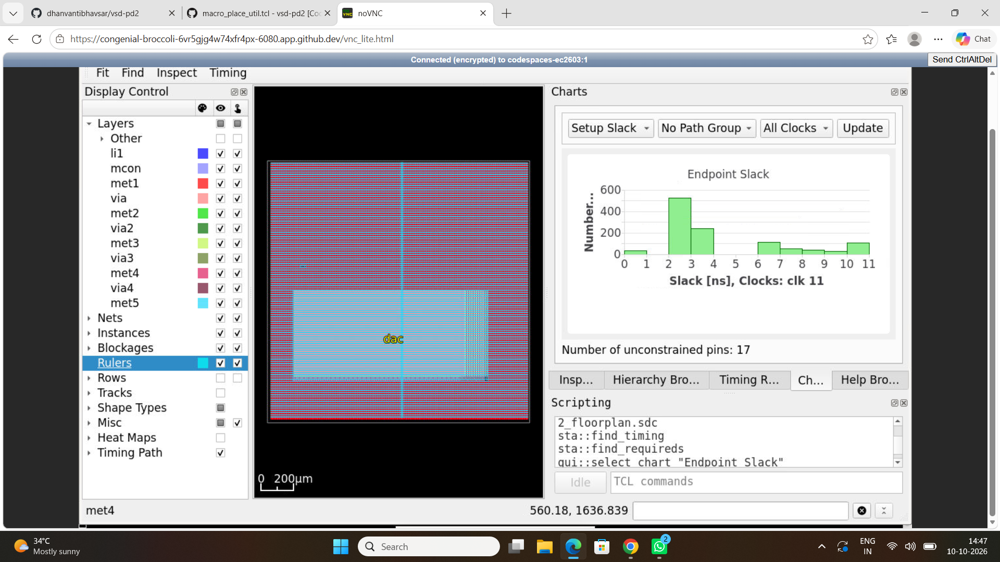
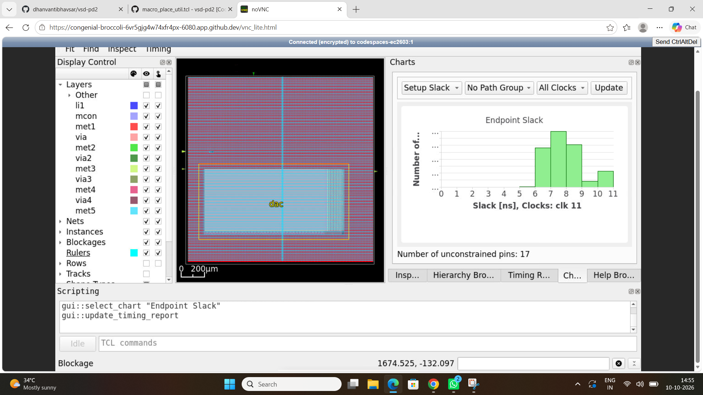
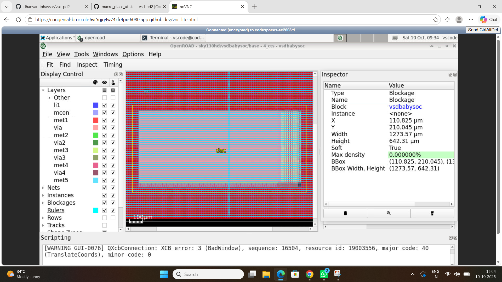
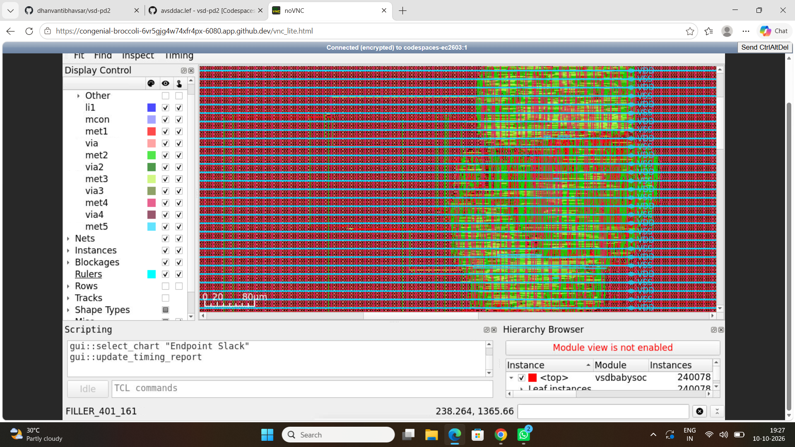
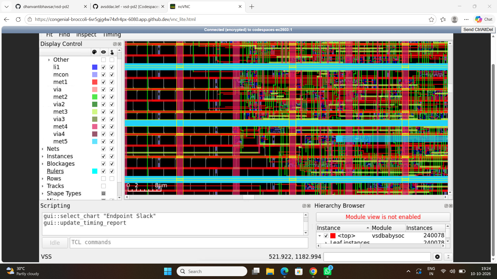
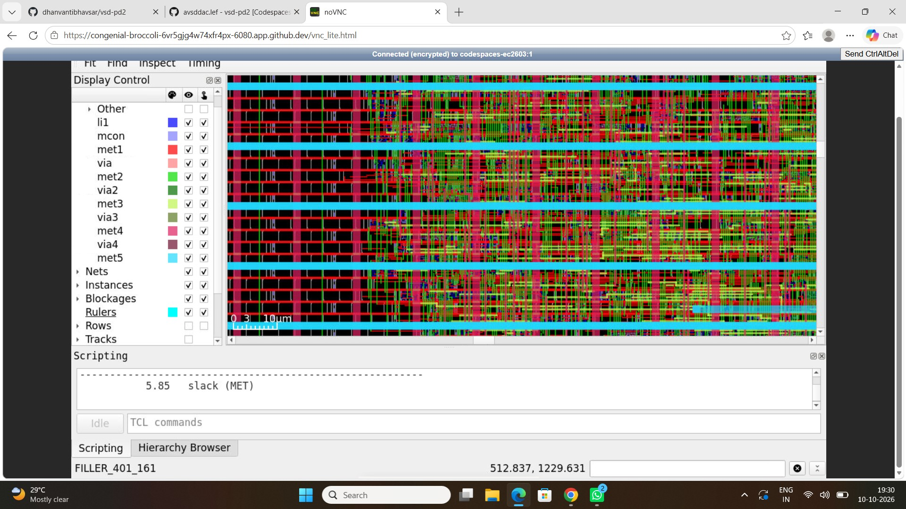

# VSDBabySoC Physical Design Using OpenROAD

## 1. Project Overview

This project documents the physical-design implementation of **VSDBabySoC** using OpenROAD-flow-scripts and the SkyWater SKY130 High-Density (HD) standard-cell library.

The project focuses on understanding the digital physical-design flow, inspecting the design at different implementation stages, and exploring timing analysis under multiple Process, Voltage, and Temperature (PVT) conditions.

### Objectives

- Understand the RTL-to-GDSII physical-design flow.
- Explore floorplanning, placement, clock-tree synthesis, and routing.
- Work with the SKY130 HD standard-cell library.
- Understand timing constraints and Static Timing Analysis (STA).
- Document implementation stages using screenshots.

## 2. Tools and Technologies

| Tool / Technology | Purpose |
|---|---|
| OpenROAD-flow-scripts | Physical-design flow automation |
| OpenROAD | Physical-design implementation |
| Yosys | RTL synthesis |
| OpenSTA | Static Timing Analysis |
| SKY130 HD | Standard-cell library |
| Liberty (`.lib`) | Cell timing models |
| SDC (`.sdc`) | Timing constraints |
| SPEF (`.spef`) | Extracted parasitic information |
| GitHub Codespaces | Development environment |

## 3. Physical Design Flow

The implementation follows the major stages of the physical-design flow.

### 3.1 Floorplanning

Floorplanning establishes the die and core regions and prepares the design for subsequent physical implementation.

### 3.2 Placement

Placement determines the physical locations of standard cells while considering placement constraints, timing, and wirelength.

### 3.3 Clock-Tree Synthesis (CTS)

Clock-tree synthesis constructs the clock distribution network to deliver clock signals to sequential elements while controlling clock skew and insertion delay.

### 3.4 Routing

Routing establishes the physical interconnections between cells. Global routing plans the interconnect paths, while detailed routing generates the detailed connections using the available routing layers.

The routing stage was completed as part of this project.

## 4. Static Timing Analysis (STA)

Static Timing Analysis evaluates the timing behavior of the implemented design without requiring functional input simulation.

STA uses timing constraints, standard-cell timing models, and interconnect parasitics where available.

Important timing checks include:

- **Setup analysis:** Checks whether data arrives before the required clock edge.
- **Hold analysis:** Checks whether data remains stable for the required interval after the clock edge.
- **Critical-path analysis:** Identifies paths with the most restrictive timing margins.

### Important Timing Metrics

| Metric | Description |
|---|---|
| WNS | Worst Negative Slack |
| TNS | Total Negative Slack |
| Setup slack | Timing margin for setup checks |
| Hold slack | Timing margin for hold checks |
| Critical path | Most timing-critical path for the selected analysis |

Actual timing results should be added from the generated reports.

## 5. Multi-Corner PVT Analysis

PVT analysis evaluates the design under different process, supply-voltage, and temperature conditions.

The project contains SKY130 HD timing libraries for multiple operating conditions, including FF, SS, and TT process corners.

- **FF:** Fast-Fast process corner.
- **SS:** Slow-Slow process corner.
- **TT:** Typical-Typical process corner.

Analyzing multiple corners helps evaluate timing behavior across different operating conditions.

The timing results should be recorded separately for each successfully analyzed corner, including setup slack, hold slack, and critical-path information.

## 6. Implementation Outputs

The physical-design flow may generate the following artifacts, depending on the configured stages and completed extraction steps:

| File | Description |
|---|---|
| `.odb` | OpenROAD implementation database |
| `.def` | Physical design and routing representation |
| `.v` | RTL or synthesized/implementation netlist |
| `.sdc` | Timing constraints |
| `.lib` | Standard-cell timing models |
| `.spef` | Extracted interconnect parasitics |
| `.gds` | Layout stream file |

The actual generated files should be verified in the implementation output directories.

## 7. Key Learning Outcomes

- Understanding the stages of digital physical design.
- Exploring floorplanning and standard-cell placement.
- Understanding clock-tree synthesis and clock distribution.
- Learning the purpose of global and detailed routing.
- Understanding the role of Liberty libraries and SDC constraints.
- Exploring STA and multi-corner PVT analysis.
- Documenting physical-design results and implementation stages.

## 8. Conclusion

This project demonstrates the physical-design workflow for VSDBabySoC using OpenROAD-flow-scripts and the SKY130 HD standard-cell library.

The work covers floorplanning, placement, clock-tree synthesis, and routing, with a focus on understanding the implementation stages and the role of timing analysis.

The final assessment of the design should be based on verified implementation outputs and actual timing reports.

## 9. References

- [OpenROAD-flow-scripts](https://github.com/The-OpenROAD-Project/OpenROAD-flow-scripts)
- [OpenROAD Documentation](https://openroad.readthedocs.io/)
- [OpenSTA](https://github.com/The-OpenROAD-Project/OpenSTA)
- [SkyWater SKY130 PDK](https://github.com/google/skywater-pdk)
